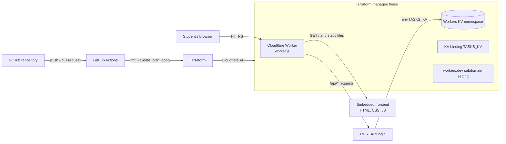

# Serverless Student Task Manager using Terraform and Cloudflare Workers

## 1. Project title and abstract

**Title:** Serverless Student Task Management Application with Infrastructure as Code (Terraform + Cloudflare Workers + Workers KV)

**Abstract:** This project is a web dashboard where students manage assignments, labs and exams. The whole backend runs on **Cloudflare Workers** (serverless, so there is no server to maintain). Tasks are stored in **Cloudflare Workers KV**. The cloud resources (Worker, KV namespace, binding, public URL) are created by **Terraform**, not by clicking in the Cloudflare dashboard. This is called *Infrastructure as Code (IaC)*. The code lives on **GitHub**, and **GitHub Actions** checks it automatically and can deploy it after a human approves.

## 2. Problem statement

Students lose track of deadlines because tasks are spread across notes, chats and notebooks. Also, building cloud infrastructure by hand is slow, hard to repeat and easy to get wrong. The problem is to build a simple task manager and to create its cloud infrastructure with code, so the same setup can be created, changed, destroyed and recreated reliably.

## 3. Objectives

- Build a responsive Student Task Management dashboard.
- Build a REST API (create, read, update, delete tasks) on Cloudflare Workers.
- Store tasks permanently in Cloudflare Workers KV (not in the browser).
- Provision the Worker and KV namespace with Terraform.
- Use Git and GitHub, with a GitHub Actions CI/CD pipeline.
- Demonstrate the Terraform lifecycle: init, fmt, validate, plan, apply, modify, destroy, recreate.

## 4. Technologies used

| Part | Technology | Why |
|---|---|---|
| Frontend | HTML, CSS, JavaScript (no framework) | Simple to read and explain |
| Serverless compute | Cloudflare Workers | Runs the API and serves the website |
| Storage | Cloudflare Workers KV | Key-value store for tasks |
| Infrastructure as Code | Terraform with the official `cloudflare/cloudflare` provider (v5) | Creates cloud resources from code |
| Cloud provider | Cloudflare | Hosts everything |
| Version control | Git and GitHub | History and teamwork |
| CI/CD | GitHub Actions | Automatic checks and controlled deployment |

Node.js is used only for two helper jobs: bundling the frontend into the Worker file (`build.js`) and running the automated tests. It is not part of the running application.

## 5. System architecture



How it works in one paragraph: `build.js` copies `index.html`, `style.css` and `script.js` into `application/worker.js` and writes one file, `dist/worker.js`. Terraform uploads that one file as the Worker and creates a KV namespace. A *binding* named `TASKS_KV` connects the two, so the code can use `env.TASKS_KV`. When you open the URL, the Worker returns the web page. The page then calls `/api/...` on the same Worker, which reads and writes KV.

## 6. Project folder structure

```text
student-task-manager-iac/
├── application/
│   ├── worker.js          Worker: REST API + KV logic + serves the frontend
│   ├── index.html         Dashboard page
│   ├── style.css          Styles (responsive)
│   ├── script.js          Frontend logic (calls the API)
│   └── wrangler.toml      LOCAL development only (not used for deployment)
├── terraform/
│   ├── providers.tf       Terraform and provider versions
│   ├── main.tf            KV namespace, Worker, binding, workers.dev URL
│   ├── variables.tf       Inputs (account ID, names)
│   ├── outputs.tf         Values printed after apply
│   ├── terraform.tfvars.example   Placeholder values (copy to terraform.tfvars)
│   └── backend.tf.example Optional remote state for GitHub Actions
├── tests/
│   └── worker.test.js     20 automated API tests
├── .github/workflows/
│   └── deploy.yml         CI/CD pipeline
├── screenshots/
│   └── README.md          Screenshot names and checklist
├── build.js               Bundles frontend into dist/worker.js
├── package.json           Scripts: build, test, dev
├── .gitignore
└── README.md
```

**Changes from the suggested structure (and why):** I added `build.js`, `package.json` and `tests/` because the frontend must be bundled into the Worker file that Terraform uploads (so the deployed app contains the real frontend, not only the API). I added `wrangler.toml` for local testing only, and `backend.tf.example` because GitHub Actions needs remote state (see section 14). `dist/` is generated and is not committed.

## 7. Application features

- Dashboard summary: total, pending, in-progress and completed tasks, plus a progress bar.
- Add, edit, delete tasks in a dialog form (title, priority, status, optional category and deadline).
- Change a task's status directly from the list.
- Search by title or category, filter by status (sidebar) and priority, sort by newest, oldest, deadline, priority or title.
- Overdue deadlines are marked.
- Loading placeholders, empty states, success messages and clear error messages.
- Responsive layout for desktop and mobile; keyboard-friendly.
- Server-online indicator that calls `/api/health`.
- Safe rendering: task text is inserted as text, never as HTML, so it cannot inject scripts.

Each task has: `id` (random UUID), `title`, `priority` (Low/Medium/High), `status` (Pending/In Progress/Completed), `category`, `deadline`, `createdAt`, `updatedAt`.

## 8. REST API documentation

Base URL: `https://<worker-name>.<your-subdomain>.workers.dev` (or `http://localhost:8787` locally).

| Method | Path | Purpose | Success | Errors |
|---|---|---|---|---|
| POST | `/api/tasks` | Create a task | 201 | 400 invalid, 409 limit reached, 413 too large |
| GET | `/api/tasks` | List all tasks (newest first) | 200 | 503 KV missing |
| GET | `/api/tasks/{id}` | Get one task | 200 | 404 not found |
| PUT | `/api/tasks/{id}` | Update one or more fields | 200 | 400 invalid, 404 not found |
| DELETE | `/api/tasks/{id}` | Delete a task | 200 | 404 not found |
| GET | `/api/health` | Health check | 200 | 503 if KV not bound or not reachable |
| OPTIONS | `/api/*` | CORS preflight | 204 | |

Other behavior: `GET /api/tasks?repair=true` rebuilds the task index (section 18). Wrong methods return 405 with an `Allow` header. Unknown API paths return 404.

**Create request**
```json
{ "title": "Finish CN lab report", "priority": "High", "status": "Pending",
  "category": "Networks", "deadline": "2030-01-31" }
```
Only `title` is required. Defaults: priority `Medium`, status `Pending`.

**Success response (201)**
```json
{ "data": { "id": "053bdcd2-8b0d-49de-9e8f-8fa8e0d40792", "title": "Finish CN lab report",
  "priority": "High", "status": "Pending", "category": "Networks", "deadline": "2030-01-31",
  "createdAt": "2026-10-15T07:34:25.998Z", "updatedAt": "2026-10-15T07:34:25.998Z" } }
```

**Error response (400)**
```json
{ "error": { "message": "Validation failed",
  "details": ["title is required and must be a non-empty string"] } }
```

Validation rules: title 1 to 120 characters; priority and status must be one of the allowed values; category up to 40 characters; deadline must be a real date in `YYYY-MM-DD` format; request body must be valid JSON, up to 10 KB. Send `null` or `""` for `deadline` or `category` in a PUT to clear them.

## 9. Cloudflare account and API token setup

1. Create a free account at <https://dash.cloudflare.com/sign-up>.
2. **Find your Account ID:** open the dashboard, go to **Workers & Pages**. The Account ID is shown on the right side (a 32-character code). It is also in the dashboard URL.
3. **Create an API token** (this lets Terraform act on your account):
   - Click your profile icon, then **My Profile**, then **API Tokens**, then **Create Token**, then **Create Custom Token**.
   - Permissions (all at **Account** level):
     - `Workers Scripts` : `Edit`
     - `Workers KV Storage` : `Edit`
   - Account Resources: *Include* your account only.
   - Create the token and **copy it once**. Cloudflare will not show it again.
4. Keep the token private. Never paste it into a file in this project, a chat or a screenshot.

These two permissions are the least I expect the project to need. I could not test against a real account, so if Terraform reports a permission error, the message names the missing permission; add only that one.

**Workers.dev subdomain:** the public URL looks like `https://student-task-manager.<your-subdomain>.workers.dev`. Your account must already have a workers.dev subdomain. If you have never used Workers, open **Workers & Pages** in the dashboard once and choose a subdomain when asked. This is an account setting, not one of the project's resources.

## 10. Local development instructions

Prerequisites: Node.js 20 or newer (<https://nodejs.org>, LTS).

```powershell
cd student-task-manager-iac
npm test          # builds dist/worker.js and runs 20 API tests (no Cloudflare account needed)
npm run dev       # runs the Worker locally with simulated KV, using Wrangler
```

`npm run dev` downloads Cloudflare's Wrangler tool on first use and serves the app at `http://localhost:8787`. Local data is kept in a `.wrangler` folder (ignored by Git). Wrangler is used **only** for local testing. Terraform creates and deploys the real Worker and KV namespace.

> If PowerShell says "running scripts is disabled on this system", run this once and try again:
> `Set-ExecutionPolicy -Scope CurrentUser RemoteSigned`

## 11. Terraform installation and setup

```powershell
winget install HashiCorp.Terraform
```

Close and reopen PowerShell, then check:

```powershell
terraform -version
node -v
git --version
```

(If `winget` is not available, download Terraform from <https://developer.hashicorp.com/terraform/install>, unzip it and add the folder to your PATH.)

Terraform needs three inputs:

| Input | How you provide it | Secret? |
|---|---|---|
| `CLOUDFLARE_API_TOKEN` | Environment variable in your PowerShell window | **Yes** |
| `cloudflare_account_id` | `terraform/terraform.tfvars` (Git-ignored) | No, but keep private |
| Optional names | `terraform/terraform.tfvars` | No |

## 12. Step-by-step deployment instructions

Run these in Windows PowerShell, one step at a time, from the project folder.

**Step 1. Build the Worker file.** This puts the frontend and API into one file.
```powershell
npm run build
```
Expected: `Built dist/worker.js (about 39 KB)`.

**Step 2. Create your variables file.**
```powershell
Copy-Item terraform\terraform.tfvars.example terraform\terraform.tfvars
notepad terraform\terraform.tfvars
```
Replace `REPLACE_WITH_YOUR_32_CHARACTER_ACCOUNT_ID` with your Account ID, save and close.

**Step 3. Give Terraform your token** (this lasts only for this PowerShell window):
```powershell
$env:CLOUDFLARE_API_TOKEN = "paste-your-token-here"
```

**Step 4. Initialize Terraform.** Downloads the Cloudflare provider and creates `.terraform.lock.hcl`.
```powershell
cd terraform
terraform init
```

**Step 5. Format and validate.**
```powershell
terraform fmt -recursive
terraform validate
```
Expected: `Success! The configuration is valid.`

**Step 6. Preview the changes (safe, changes nothing).**
```powershell
terraform plan
```
Expected: a plan that **creates 3 resources**: the KV namespace, the Worker script and the workers.dev setting (`Plan: 3 to add, 0 to change, 0 to destroy`).

**Step 7. Create the infrastructure.** This creates real Cloudflare resources in your account. The free plan is expected to be enough for a demo, but check Cloudflare's current pricing and limits. Terraform asks for confirmation; type `yes` only when you are ready.
```powershell
terraform apply
```

**Step 8. Get the URL.** Open `terraform\terraform.tfvars`, set `workers_subdomain = "your-subdomain"` (see "Workers.dev subdomain" in section 9), then run `terraform apply` again. Only the output changes. Then:
```powershell
terraform output worker_url
```
Open that address in your browser.

**Step 9. Commit the lock file** (see section 13): `terraform/.terraform.lock.hcl` pins the provider version, so teammates and GitHub Actions use the same one.

### Modifying the infrastructure safely

Always follow the same loop: **edit, `terraform fmt`, `terraform validate`, `terraform plan`, read the plan, then `terraform apply`.**

- Change the website or API: edit files in `application/`, run `npm run build` from the project root, then `terraform plan`. Expect `cloudflare_workers_script.app will be updated in-place`.
- Change a setting (for example `compatibility_date`): edit `terraform.tfvars` or `variables.tf`, then plan and apply.
- **Read the symbols in the plan:** `+` create, `~` update in place, `-` destroy, `-/+` replace. Be careful with `-` and `-/+`, especially on the KV namespace (it holds your data).

## 13. GitHub repository setup

1. Create an **empty** repository on GitHub (no README) named `student-task-manager-iac`.
2. In PowerShell, from the project folder:
```powershell
git init
git add .
git status
```
3. **Check the `git status` list.** You must **not** see `terraform.tfvars`, `.tfstate` files, `.terraform/`, `node_modules/` or `dist/`. If you see one, stop and fix `.gitignore` before continuing.
4. Commit and push:
```powershell
git commit -m "Initial commit: serverless task manager with Terraform"
git branch -M main
git remote add origin https://github.com/<your-username>/student-task-manager-iac.git
git push -u origin main
```
5. After your first `terraform init`, also commit the lock file: `git add terraform/.terraform.lock.hcl`, then commit and push.

## 14. GitHub Actions CI/CD configuration

The workflow `.github/workflows/deploy.yml` has three jobs:

| Job | Runs when | What it does | Needs secrets? |
|---|---|---|---|
| `validate` | Every pull request and push | Builds the bundle, runs the 20 tests, `terraform fmt -check`, `terraform init -backend=false`, `terraform validate` | No |
| `plan` | After `validate`, only if `ENABLE_DEPLOY` is `true` | Builds the bundle, runs `terraform plan`, saves the plan | Yes |
| `apply` | Only on push to `main`, after a human approves | Applies the **exact saved plan**, then calls `/api/health` as a smoke test | Yes |

Destroy is **not** in the pipeline. Destroying is always a manual, deliberate action on your own computer.

**The `validate` job works immediately after you push, with no setup.** To also deploy from GitHub, do this one-time setup:

**A. Remote state.** A GitHub runner is a fresh machine each time, so it cannot see the state file on your laptop. Without shared state, Terraform would try to create everything again. Use a free HCP Terraform account:
1. Sign up at <https://app.terraform.io>, create an organization, then create a workspace named `student-task-manager`. In the workspace settings set **Execution Mode** to **Local**.
2. Create an API token for yourself (User settings, Tokens).
3. Copy `terraform/backend.tf.example` to `terraform/backend.tf` and put in your organization name.
4. Run `terraform login`, then in the `terraform` folder run `terraform init -migrate-state`. Commit `backend.tf`.

**B. GitHub Secrets** (repository, **Settings, Secrets and variables, Actions, New repository secret**):

| Secret name | Value |
|---|---|
| `CLOUDFLARE_API_TOKEN` | Your least-privilege Cloudflare token (section 9) |
| `CLOUDFLARE_ACCOUNT_ID` | Your 32-character Account ID |
| `TF_API_TOKEN` | Your HCP Terraform token (step A2) |

**C. GitHub Variables** (same page, **Variables** tab):

| Variable | Value |
|---|---|
| `ENABLE_DEPLOY` | `true` (turns on the plan and apply jobs) |
| `WORKERS_SUBDOMAIN` | Your workers.dev subdomain (for the smoke test) |

**D. Approval gate.** In **Settings, Environments, New environment**, create `production` and add yourself as a **Required reviewer**. The `apply` job then waits for your click. (GitHub may limit required reviewers on *private* repositories to paid plans. If that applies to you, make the repository public or keep `ENABLE_DEPLOY` unset and deploy from your computer.)

Secrets are never printed in logs: GitHub masks them, and the workflow never echoes them.

## 15. Terraform lifecycle commands and their purposes

| Command | Purpose | Changes the cloud? |
|---|---|---|
| `terraform init` | Downloads the provider and prepares the folder | No |
| `terraform fmt -recursive` | Auto-formats `.tf` files to the standard style | No |
| `terraform validate` | Checks syntax and references | No |
| `terraform plan` | Shows what *would* change | No |
| `terraform apply` | Makes the changes (asks you to type `yes`) | **Yes** |
| `terraform output` | Prints output values (URL, IDs) | No |
| `terraform destroy` | Deletes everything Terraform manages (asks you to type `yes`) | **Yes, deletes** |

**Demonstrating modify, destroy and recreate (for your viva):**
1. *Modify:* change a word in `application/index.html`, run `npm run build`, then `terraform plan` and `terraform apply`. Refresh the website to see the change.
2. *Destroy:* run `terraform destroy`. **Impact:** the Worker, the KV namespace **and every task stored in it are permanently deleted**. Type `yes` only if you are sure.
3. *Recreate:* run `npm run build` (if `dist/` is missing) then `terraform apply`. You get a new Worker and a **new, empty** KV namespace with a new ID. Old tasks do not come back. This is the key lesson about state and data.

## 16. Testing instructions and expected results

### Automated tests (no Cloudflare needed)
```powershell
npm test
```
Expected: `# tests 20`, `# pass 20`, `# fail 0`. These run against the real `dist/worker.js` bundle with a small in-memory fake of KV.

### Manual checklist (against your deployed URL)

Set the address once in PowerShell:
```powershell
$base = "https://student-task-manager.YOUR-SUBDOMAIN.workers.dev"
```

| # | Test | Command or action | Expected result |
|---|---|---|---|
| 1 | Health endpoint | `Invoke-RestMethod "$base/api/health"` | `status: ok`, `kvBound: True`, `kvReachable: True` |
| 2 | Create a task | `$t = Invoke-RestMethod -Method Post -Uri "$base/api/tasks" -ContentType "application/json" -Body (@{title="Test task";priority="High"} \| ConvertTo-Json)` | Returns `data` with an `id`; status 201 |
| 3 | List tasks | `Invoke-RestMethod "$base/api/tasks"` | `count` is 1 or more |
| 4 | View one task | `Invoke-RestMethod "$base/api/tasks/$($t.data.id)"` | The same task |
| 5 | Update a task | `Invoke-RestMethod -Method Put -Uri "$base/api/tasks/$($t.data.id)" -ContentType "application/json" -Body (@{status="Completed"} \| ConvertTo-Json)` | `status` is `Completed` |
| 6 | Invalid input | `try { Invoke-RestMethod -Method Post -Uri "$base/api/tasks" -ContentType "application/json" -Body '{"title":""}' } catch { $_.Exception.Response.StatusCode.value__; $_.ErrorDetails.Message }` | `400` and a `details` message |
| 7 | Missing task | `try { Invoke-RestMethod "$base/api/tasks/nope" } catch { $_.Exception.Response.StatusCode.value__ }` | `404` |
| 8 | Delete a task | `Invoke-RestMethod -Method Delete -Uri "$base/api/tasks/$($t.data.id)"` | Returns the deleted `id`; a later GET gives 404 |
| 9 | Search and filter | In the website: type in the search box, click *Pending* in the sidebar, choose a priority | The list narrows; clearing shows all |
| 10 | Persistence | Add a task, press F5 (refresh), or open the site in another browser | The task is still there (it is in KV, not the browser) |
| 11 | Terraform checks | `terraform fmt -check -recursive` and `terraform validate` in `terraform/` | No file names listed; "configuration is valid" |
| 12 | GitHub Actions | Push a commit, open the **Actions** tab | `validate` job is green |
| 13 | Deployed Worker and KV binding | Cloudflare dashboard, **Workers & Pages**, open the Worker, then **Bindings** | `TASKS_KV` is listed; the health endpoint shows `kvBound: True` |

### What has actually been verified so far

This section reports honestly what was run while this project was created, and what you must still run.

| Check | Status |
|---|---|
| 20 automated API tests (`npm test`) | **Run: 20 passed** |
| Full create/read/update/delete flow in the real Workers runtime (`workerd`) with simulated KV, including a server restart to confirm data persisted | **Run: passed** |
| Frontend logic (render, search, filters, sort, status change, delete, error display, HTML escaping) in a simulated browser (jsdom) | **Run: passed** |
| GitHub Actions workflow file is valid YAML | **Run: passed** |
| `terraform fmt`, `validate`, `plan`, `apply` | **Not run.** Terraform could not be installed in the build environment. I wrote the configuration against the current provider documentation. You must run these (section 12). |
| Real Cloudflare deployment, real KV, GitHub Actions run | **Not run.** Needs your account and repository. |
| Visual appearance in a real browser, mobile layout | **Not checked visually.** Please look at it and take the screenshots. |

## 17. Security considerations

- **No secrets in code.** The Cloudflare token comes from the `CLOUDFLARE_API_TOKEN` environment variable or GitHub Secrets. `terraform.tfvars.example` has placeholders only.
- **Least privilege.** The token has only Workers Scripts: Edit and Workers KV Storage: Edit, limited to one account.
- **`.gitignore`** excludes `.terraform/`, `*.tfstate`, `*.tfstate.*`, `*.tfvars`, `.env`, `node_modules/` and `dist/`.
- **State file security.** The Terraform state records your resource IDs and settings. It can contain sensitive values in other projects, so treat it as private: never commit it, and do not share screenshots of it. Remote state (HCP Terraform) keeps it off GitHub. The saved plan artifact in CI is kept for 3 days only.
- **Destroying a KV namespace destroys its data.** Terraform will delete the namespace and all tasks in it. There is no undo. Always read the `plan` first, and export data you need before destroying.
- **No login (important limitation).** Anyone who knows the URL can read and change the tasks. That is fine for a demo with fake data, but do not store private information. A future improvement is Cloudflare Access (login) in front of the Worker.
- **CORS** is set to `*` so the API can be tested from other origins. The website itself uses the same origin. Restrict this if you add login.
- **Input safety.** The API validates every field and limits the body to 10 KB. The frontend inserts text with `textContent`, and the Worker sends a Content-Security-Policy and other security headers.
- **Approval before changes.** Production applies need a human approval, and destroy is never automated.

## 18. Cloudflare KV limitations (and how this project handles them)

**Storage design:** one key per task (`task:<id>`) plus one key `index` that holds the list of task IDs.

| Limitation | Meaning | How the project copes |
|---|---|---|
| **Eventual consistency** | A write may take up to about a minute to be visible in other Cloudflare locations. Reads right after a write can be stale. | Fine for a personal task list. The page updates from the API response, not from a re-read. |
| **No transactions** | Saving a task and updating the index are two separate writes. If the Worker stops between them, they can disagree. | The task is written **first**, then the index. A missing index entry can be repaired; a stale one is skipped. |
| **Lost updates on the index** | Two requests at the same moment can overwrite each other's index change (read-modify-write). | The index update is verified and retried a few times. This **reduces** the risk but does **not** remove it. |
| **Repair path** | | If the index is missing, the next `GET /api/tasks` rebuilds it from the task keys. You can also force this with `GET /api/tasks?repair=true`. |
| **Subrequest limit** | A Worker may only make a limited number of calls per request (listing reads one KV key per task). | The app allows at most **40 tasks** (creating more returns 409). |
| **Write limits** | KV is built for read-heavy data. Only about one write per second per key is allowed, and the free plan has daily quotas. | Fine for one student. Check Cloudflare's *current* limits page before heavy use. |

KV is not a relational database. For many users or strict consistency, use D1 (SQL) or Durable Objects instead.

## 19. Common errors and troubleshooting

| Problem | Likely cause | Fix |
|---|---|---|
| `Error: Invalid function argument ... file("...dist/worker.js")` or "no such file" | The bundle has not been built | Run `npm run build` from the project root, then retry |
| `terraform` is not recognized | Terraform not installed or PATH not refreshed | Reinstall, then close and reopen PowerShell |
| Authentication error / `401` / `403` / "permission" | Token missing, expired or lacking a permission | Re-set `$env:CLOUDFLARE_API_TOKEN` in this window. Add the permission named in the error |
| Error about a **subdomain** | Your account has no workers.dev subdomain yet | Open **Workers & Pages** in the dashboard once and choose a subdomain, then re-run `terraform apply` |
| `terraform fmt -check` fails in GitHub | A file is not formatted | Run `terraform fmt -recursive` locally and commit |
| Plan always shows changes to `bindings` | A known class of behavior in some v5 provider releases | Run `terraform init -upgrade` to get the newest v5 provider, then plan again |
| Page loads but "Tasks could not be loaded" | API or KV problem | Open `/api/health`. If `kvBound` is false, the binding is missing: re-run `terraform apply` |
| After `destroy` + `apply`, tasks are gone | A new KV namespace was created | Expected; see section 15 |
| Workflow `plan` fails: "terraform/backend.tf is missing" | Remote state not set up | Follow section 14, step A |
| `running scripts is disabled` in PowerShell | Execution policy | `Set-ExecutionPolicy -Scope CurrentUser RemoteSigned` |
| `git status` shows `terraform.tfvars` | `.gitignore` not applied | Do not commit. Run `git rm --cached terraform/terraform.tfvars` and check `.gitignore` |

## 20. Screenshot checklist

Save screenshots in `screenshots/` using the names in `screenshots/README.md`. **Before each screenshot, check that no API token, Account ID you want private, or email is visible.**

How to capture on Windows: press **Win + Shift + S**, drag the area, and the image is copied. Paste it into Paint or Photos and save it as PNG. For the mobile view, open the site, press **F12**, click the phone/tablet icon (device toolbar) and capture.

- [ ] `terraform init` output
- [ ] `terraform fmt` and `terraform validate` success
- [ ] `terraform plan` (3 resources to add)
- [ ] `terraform apply` complete, with outputs
- [ ] Worker in the Cloudflare dashboard
- [ ] KV namespace and the `TASKS_KV` binding
- [ ] Dashboard with several tasks
- [ ] Add-task form
- [ ] Search and filter in action
- [ ] Mobile layout
- [ ] `/api/health` response
- [ ] Tasks still present after refresh
- [ ] Green GitHub Actions run
- [ ] Modify step (plan showing an in-place update)
- [ ] `terraform destroy` output
- [ ] Recreate step (`terraform apply` after destroy)

### Suggested demo order for your evaluator (about 8 minutes)
1. Show the folder structure and explain the architecture diagram (section 5).
2. Open `main.tf` and explain the four resources and the binding `TASKS_KV`.
3. Run `terraform plan` live; explain `+` for create.
4. Show the running app: add a task, search, filter, change status, refresh to prove persistence.
5. Open `/api/health` and one API call in PowerShell.
6. Show the GitHub Actions run and explain validate / plan / approved apply.
7. Modify the title, rebuild, plan (in-place update), apply.
8. Explain what `destroy` would delete, including KV data, and why it is manual. (Run it only if the evaluator asks.)
9. Mention the limitations: KV consistency, no transactions, no login.

## 21. Conclusion and possible future enhancements

This project shows how a small serverless application can be built and its infrastructure fully described in code. Terraform makes the setup repeatable, GitHub Actions adds automatic checks, and an approval step keeps production changes controlled.

Possible improvements:
- Add login with Cloudflare Access or user accounts, and one task list per user.
- Move to Cloudflare **D1** (SQL) for stronger consistency and easier queries.
- Add pagination and a larger task limit.
- Add email or push reminders using Worker cron triggers.
- Split Terraform into modules and add a staging environment.
- Add browser-level end-to-end tests.
